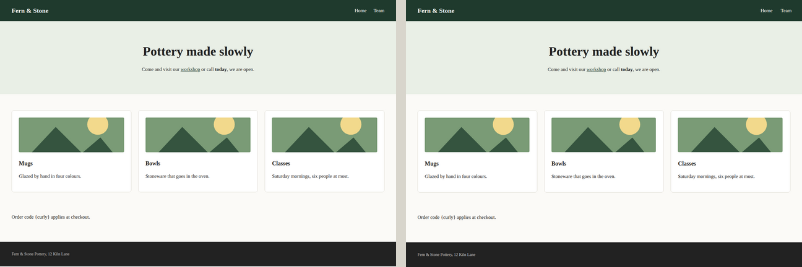
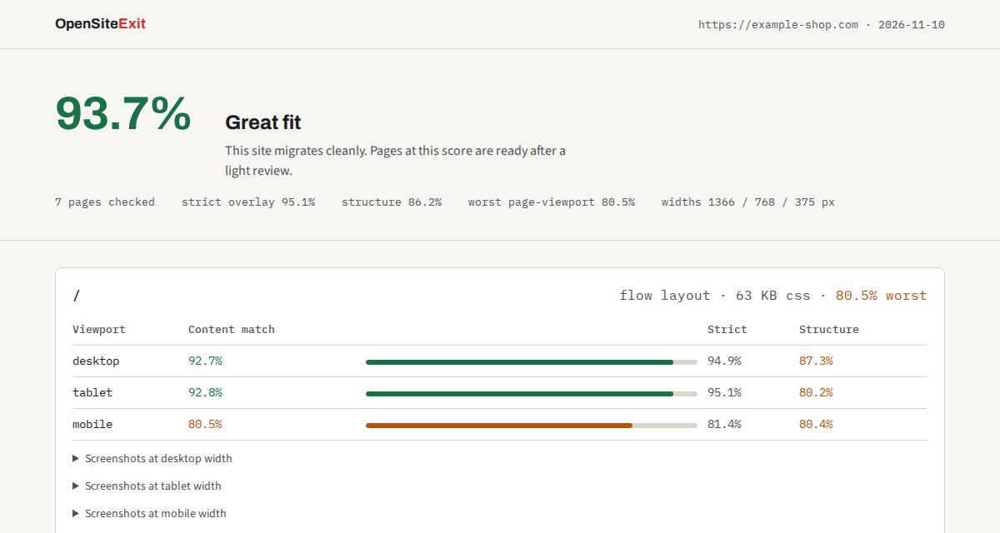

# OpenSiteExit

> Migrate website-builder sites to a codebase you own, with measured proof of fidelity.


Wix has no export. Squarespace exports blog posts and nothing else. Leaving
means rebuilding the site by hand.

OpenSiteExit does the rebuild. It measures a live site the way a visitor sees
it, writes an [Astro](https://astro.build) project that reproduces it, and
then checks its own work: every page is compared with the original at three
screen widths and scored. You get the code and a **fidelity report** that says
how close it is, page by page.



*The test fixture in `test/fixture`: original on the left, rebuild on the right.*



*The report from the benchmark run below, with the site's name replaced.*

## Quick start

Requires Node.js 20 or newer.

```sh
git clone https://github.com/hamzarehmandeveloper/opensiteexit.git
cd opensiteexit
npm install
npx playwright install chromium

node run.mjs https://www.example.com --max-pages 10
```

The run writes three folders:

```
work/<hostname>/
├── study/             measurements, screenshots and assets from the original
├── site/              the generated Astro project
└── fidelity-report/   index.html with scores, screenshots and diffs
```

The generated project is self-contained:

```sh
cd work/<hostname>/site
npm install
npm run dev      # preview
npm run build    # static files in dist/, host them anywhere
```

## What you get

- **One `.astro` page per URL**, at the same path as before, with its text,
  links and images in place. Images are downloaded into the project.
- **Plain CSS**, one stylesheet per page. A rule states a property only where
  it differs from the parent element or the browser default.
- **Layout at every width.** Pages are measured at 1366, 768 and 375 px.
  Between those widths a small script scales the page to fit, so it does not
  overflow at a width nobody measured.
- **Search engines keep their bearings.** Titles, descriptions, headings and
  canonical tags carry over. The project includes `sitemap.xml`, `robots.txt`
  and a `_redirects` file.
- **A fidelity report** with three scores per page and viewport, side-by-side
  screenshots, diff overlays and a table comparing the SEO tags.

## How the result is scored

| Score | What it measures |
|---|---|
| Content match | Pixel similarity, tolerating small vertical shifts between sections. The headline number. |
| Strict | Pixel similarity as an exact overlay. |
| Structure | The share of measured elements that came out at their measured size. |

Pixel scores alone are easy to fool: text on a white background matches white
whether or not it is laid out correctly. The structure score exists to catch
that. The report also warns when the original did not finish loading while it
was measured, and when images in the rebuild are not visible.

The overall verdict is *great fit* at 90% content match or more, *needs a
refinement pass* from 70%, and *not a fit yet* below that.

## Benchmark

One fully automated run against a real seven-page shop site on Squarespace,
with no manual fixes:

| Content match | Strict | Structure | Layout | CSS per page |
|---|---|---|---|---|
| **93.7%** | 95.1% | 86.2% | flow on all 7 pages | 23 to 106 KB |

Runs against a Wix restaurant site, an animation-heavy Wix site and a Shopify
storefront were made with an earlier version and are not comparable. The
storefront and the animated site scored poorly and are out of scope, see below.
Use the benchmark issue template to add your own run; real sites are how the
generator improves.

## How it works

| Stage | Script | What it does |
|---|---|---|
| Study | `study.mjs` | Headless Chromium visits the site, follows same-origin links, hides popups and consent banners, and records every visible element's computed styles and box at three widths, along with text, meta tags, screenshots and images. |
| Build | `build.mjs` | Turns the measurements into an Astro project. Layout is reproduced as normal flow where possible. Containers whose children are placed by grid areas or absolute positioning are rebuilt from measured coordinates. |
| Check | `check.mjs` | Builds the project, screenshots it under the same conditions and scores it against the original. Writes the fidelity report. |
| Refine | `refine.mjs` | Writes a brief per low-scoring page with the scores, diff images, files to edit and the command that re-checks it, for a person or a coding agent to work from. |

`run.mjs` runs the first three in order. If a page scores under 75% it is
rebuilt entirely from measured coordinates ("pinned" layout), and that version
is kept only if it scores better.

The crawler reads only what a visitor's browser receives: rendered output,
computed styles and public assets.

## Commands

```
node run.mjs   <url> [--max-pages N] [--work DIR] [--no-fallback]
node study.mjs <url> [--max-pages N] [--out DIR]
node build.mjs [--study DIR] [--out DIR] [--pin-all slug,…|all]
node check.mjs [--study DIR] [--site DIR] [--out DIR] [--only slug]
node refine.mjs [--work DIR] [--threshold 0.9] [--max-pages N] [--agent "<cmd>"]
node tools/mismatches.mjs --work DIR [--page slug] [--viewport desktop|tablet|mobile]
```

`tools/mismatches.mjs` lists the elements of a rebuilt page that came out the
wrong size, grouped by kind. It is the fastest way to find the cause of a low
structure score.

## What it does not do

- **Behaviour.** Menus that open, sliders, form submission and anything else
  driven by scripts is not reproduced. The rebuild is static HTML and CSS.
- **Storefronts.** Carts, checkout, inventory, bookings and member areas are
  out of scope. Keep those on a platform built for them.
- **Hand-written code.** The output is generated from measurements. It is
  plain and editable, with generated class names like `e42`, and it is not the
  semantic component structure a developer would write.
- **Mobile-only elements.** The page structure is taken from the desktop
  layout, so an element that exists only on phones, such as a menu button, is
  missing.
- **Heavy animation.** Video backgrounds, parallax and carousels score badly.
- **Exact fonts.** Fonts available on Google Fonts are linked. Others fall
  back to the next family in the stack.

## Responsible use

Use this to migrate sites you own or are authorized to migrate. Your content
is yours. Builder template designs are licensed by the platforms, and other
people's sites are theirs. Do not use this project to copy work that is not
yours.

If you run it as a service, read [SECURITY.md](SECURITY.md).

## Contributing

See [CONTRIBUTING.md](CONTRIBUTING.md). `npm test` migrates a small fixture
site end to end in about a minute.

## Acknowledgments

The measure, generate, compare loop follows
[craft-anything](https://github.com/storytold/craft-anything). The project is
built on [Playwright](https://playwright.dev), [Astro](https://astro.build) and
[pixelmatch](https://github.com/mapbox/pixelmatch).

## License

[MIT](LICENSE)
